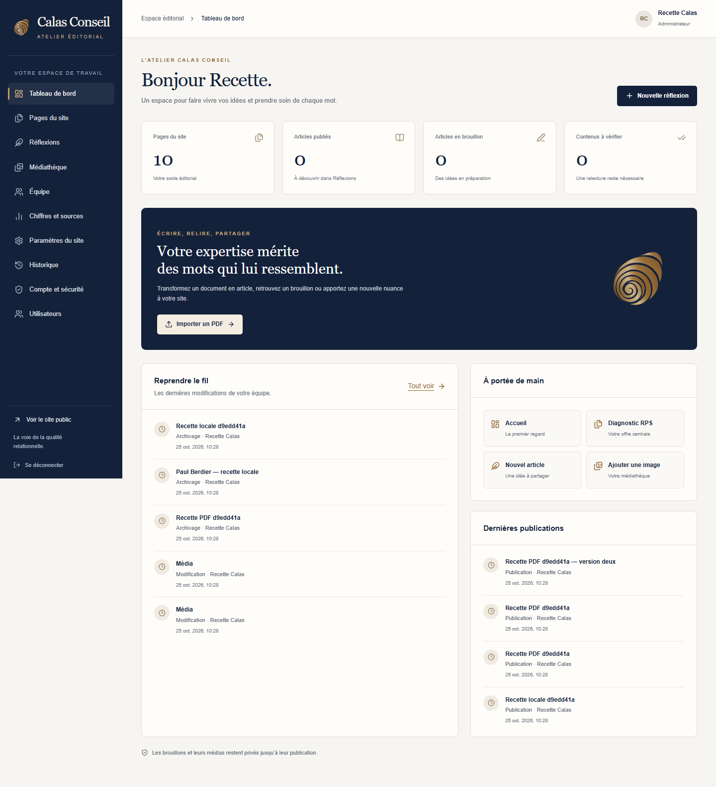
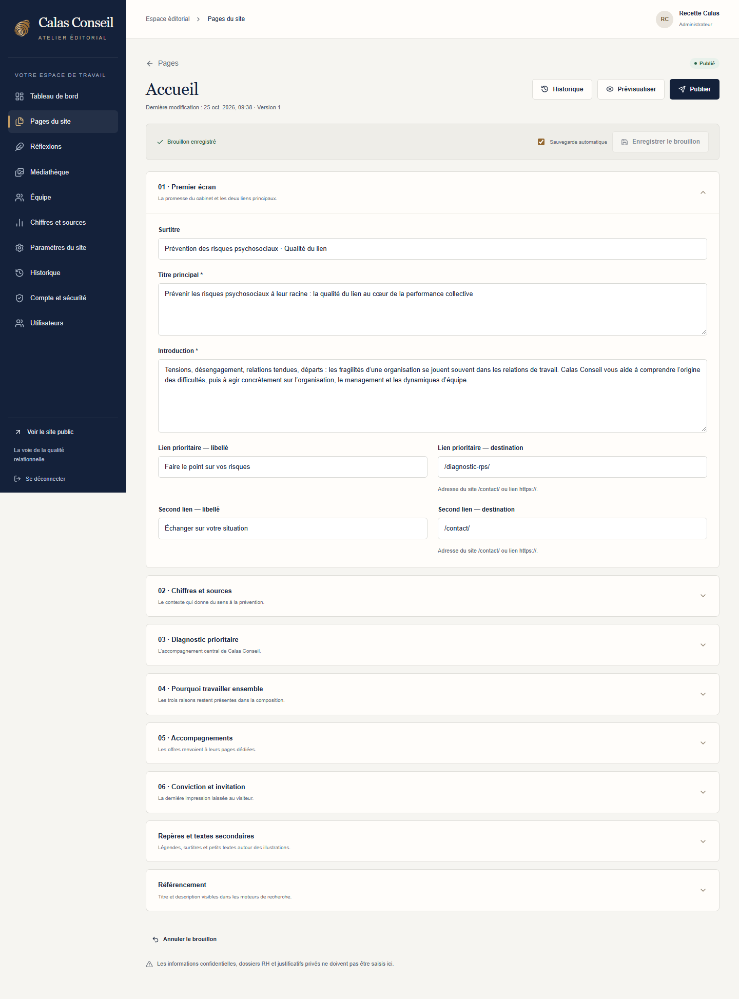
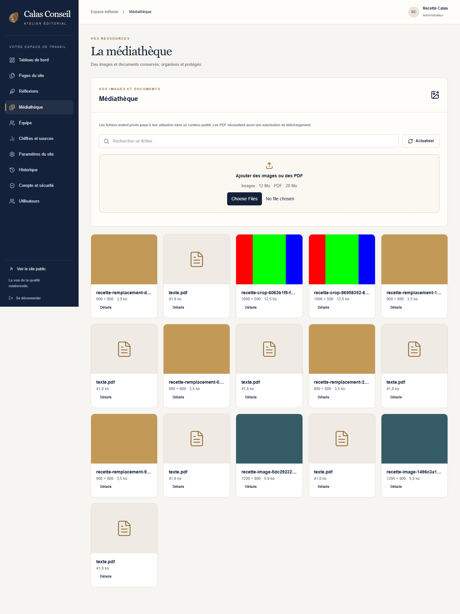
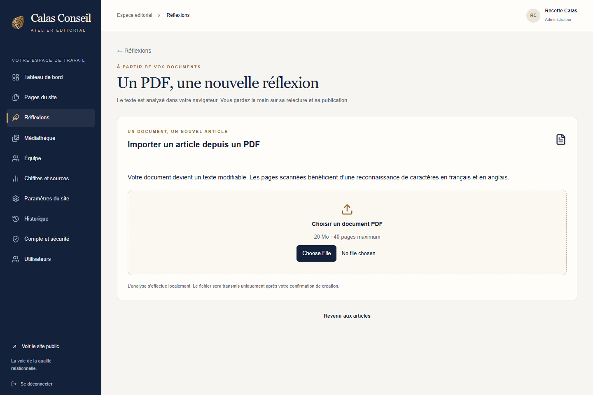
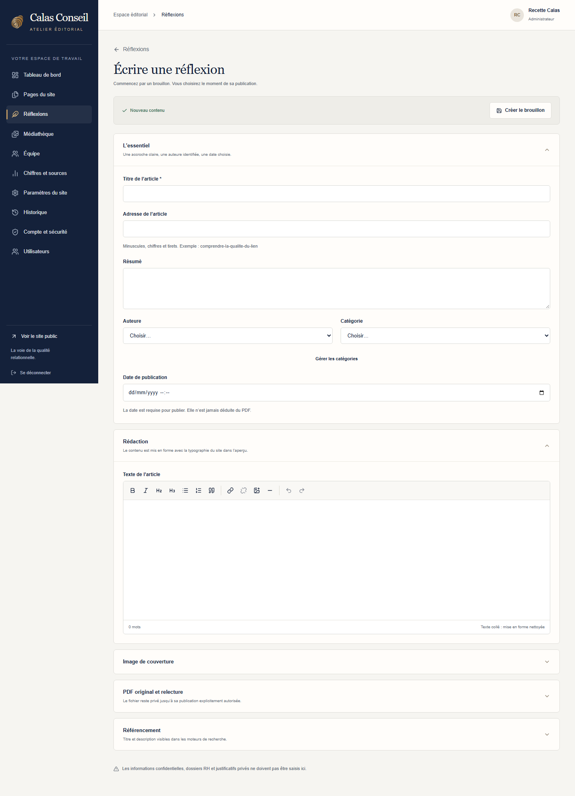
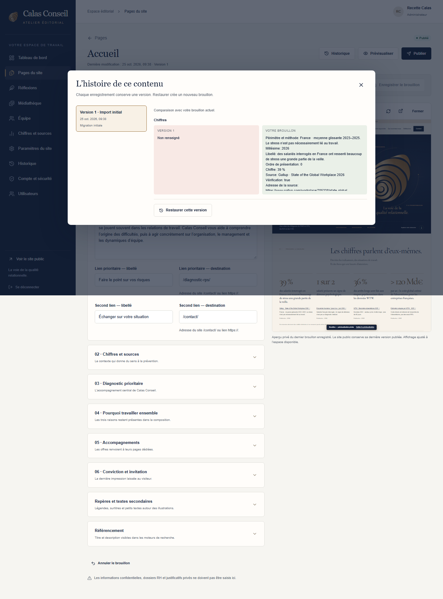

# Faire vivre le site — guide pour Sara

L’**Atelier éditorial Calas Conseil** est l’administration privée du site. Vous y modifiez les textes et les images, préparez vos articles et choisissez leur publication. Aucun compte Sanity, terminal ou outil de programmation n’est nécessaire.

Ouvrez [l’administration de Calas Conseil](https://www.calas-conseil.fr/admin/login/) pour accéder au site en production. Les captures d’écran du guide illustrent une version de recette avec des contenus de démonstration.

## Se connecter la première fois

Les comptes personnels de Sara, d’Agnès et de Paul sont déjà créés. Pour ces trois comptes, la connexion se fait avec l’adresse email personnelle et le mot de passe.

1. Ouvrez [l’écran de connexion](https://www.calas-conseil.fr/admin/login/). Saisissez l’adresse de votre compte et le mot de passe remis par Paul, puis cliquez sur **Continuer**.
2. Si l’écran **Activer votre accès** apparaît, cliquez sur **Recevoir un lien**. Dans votre boîte personnelle, ouvrez le message de Calas Conseil et suivez le lien pour confirmer votre adresse. Pensez aux courriers indésirables si le message tarde à apparaître.
3. Reconnectez-vous avec la même adresse et le même mot de passe. Le tableau de bord s’ouvre et vous pouvez choisir **Réflexions**.

Une fois votre adresse vérifiée, passez directement à la connexion lors de vos prochaines visites. Sara et Agnès peuvent publier les contenus. Paul dispose également de la gestion des utilisateurs.

## Retrouver ses contenus

Le tableau de bord donne accès à l’accueil, à Diagnostic, au nouvel article et à la médiathèque. Ses compteurs correspondent aux données enregistrées. L’activité récente indique les personnes et les dates des modifications.

Le menu rassemble **Pages du site**, **Réflexions**, **Médiathèque**, **Équipe**, **Chiffres et sources** et **Historique**. Sur téléphone, le bouton de menu ouvre ces rubriques. **Paramètres du site** et **Utilisateurs** sont réservés aux administrateurs.

## Modifier une page

1. Ouvrez **Pages du site**, puis **Accueil**, **Diagnostic RPS** ou la page concernée.
2. Dépliez la section à modifier et ajustez ses textes. L’accueil suit désormais sept blocs : premier écran, Pourquoi maintenant, chemin en trois temps, conviction, binôme, chiffres et invitation finale. Diagnostic conserve ses cinq étapes.
3. Attendez **Brouillon enregistré**. La sauvegarde automatique intervient après une courte pause de saisie ; vous pouvez aussi utiliser **Enregistrer le brouillon**, ou `Ctrl+S` / `Cmd+S`.
4. Cliquez sur **Prévisualiser**. Vérifiez le résultat aux largeurs Ordinateur, Tablette et Mobile.
5. Faites relire, puis cliquez sur **Publier** lorsque le texte est approuvé. Confirmez l’action ; la réussite n’est annoncée qu’après enregistrement par le serveur.

**Enregistrer un brouillon ne change pas le site public.** Celui-ci conserve la dernière version publiée. L’aperçu montre le dernier brouillon enregistré et nécessite votre connexion. Envoyer son adresse seule à une personne sans accès ne lui ouvre pas le brouillon.

Les trois cartes du chemin possèdent chacune leur petit libellé, leur titre, leur présentation et leur lien. Le champ **Phrase d’ouverture — gras et italique** contient la première phrase, affichée seule en gras et en italique ; **Suite de la présentation** contient le paragraphe qui suit. Saisissez uniquement le texte, sans astérisques ni balises : la mise en forme est automatique. Ces champs correspondent à `lead` et `text` dans le contenu enregistré.

Dans **Notre conviction**, **Phrase finale en italique** permet de modifier la phrase « Quand on se sent en sécurité, on ose : c’est là que naît l’autonomie. ». Elle est séparée du texte courant et affichée automatiquement en italique. Laisser ce champ vide retire cette phrase ; son nom technique est `closingQuote`.

Le passage vers **Situations sensibles** se modifie juste après les trois cartes du chemin. La page correspondante est également accessible dans **Pages du site** et présente ses cinq formats ainsi que le cadre et les limites d'intervention.

Les liens de contact prévus sont `/contact/?objet=diagnostic`, `/contact/?objet=equipes`, `/contact/?objet=managers`, `/contact/?objet=sensible` ou `/contact/`. L'objet correspondant est présélectionné pour le visiteur. Utilisez une adresse complète commençant par `https://` pour les liens externes.

Si l’enregistrement échoue, votre saisie reste à l’écran : corrigez les champs indiqués ou réessayez. Sans confirmation, la modification n’est pas enregistrée. Si une autre personne a modifié le même document, comparez les versions puis rechargez celle du serveur ; recopiez auparavant les passages à conserver. L’outil n’écrase pas automatiquement le travail de votre collègue.

## Ajouter une image ou remplacer un portrait

Dans un champ image, ouvrez la médiathèque et choisissez un fichier existant ou ajoutez une photographie authentique dont vous détenez les droits. Formats acceptés : JPEG, PNG et WebP, jusqu’à 12 Mo par image.

Renseignez le **texte alternatif**, qui décrit le contenu utile aux personnes qui ne voient pas l’image. Ajustez le cadrage et le point d’intérêt, puis vérifiez l’aperçu mobile. Un portrait s’édite dans **Équipe**, sur la fiche de la personne.

Dans **Pages du site → Accueil → Images de l’accueil**, dix champs sont disponibles : les fils dorés, le nautile, les racines, la boussole, l’arbre, le kintsugi, les ondes, les oiseaux, **Visage apaisé — fin de Notre conviction** (`calmFace`) et **Photo de l’invitation finale**. Les huit premiers remplacent les illustrations proposées par Sara ; retirer leur image de remplacement rétablit l’illustration initiale. Les deux derniers accueillent des photographies facultatives : sans image, leur emplacement photographique n’est pas affiché.

Deux photographies de banque d’images ont d’abord été sélectionnées et publiées le 2 novembre : un visage apaisé pour la fin de Notre conviction et un échange entre collègues pour l’invitation finale. Paul a ensuite demandé le retrait du visage de la femme rousse : le champ **Visage apaisé — fin de Notre conviction** (`calmFace`) est désormais vide, en local et sur Railway. Son fichier reste privé dans la médiathèque et les versions antérieures ; il n’est plus affiché sur le site. Aucun remplacement n’a été demandé. La photo d’échange est conservée. Leurs sources et licences restent consignées dans [MEDIA.md](MEDIA.md#photographies-dillustration--corrections-du-2-novembre-2026). Ce sont des illustrations, pas des portraits du cabinet ni des témoignages de clientes.

Le portrait réel de Sara, fourni le 2 novembre, est déjà utilisé sur l’accueil et dans Qui sommes-nous. Le portrait d’Agnès reste à fournir ; sa présentation typographique est conservée. Aucun visage de banque d’images ne remplace un portrait de Sara ou d’Agnès. Pour les photographies d’atelier ou de personnes, vérifiez les droits d’utilisation et l’accord des personnes représentées. La provenance et les emplacements des illustrations sont indiqués dans [les évolutions du 1er novembre](EVOLUTIONS-20261101.md#sélection-des-images).

Les médias restent privés tant qu’ils ne sont pas utilisés par un contenu publié. Remplacer le fichier d’une image partagée peut modifier ses différentes utilisations : l’opération est réservée à l’administrateur et demande une confirmation explicite. Pour changer seulement une page, sélectionnez une nouvelle image dans cette page. Un fichier lié à un contenu ou à une version conservée ne peut pas être supprimé.

## Créer une réflexion à partir d’un PDF

1. Depuis le tableau de bord ou **Réflexions**, cliquez sur **Importer un PDF** et choisissez votre document.
2. Attendez l’analyse dans votre navigateur. Le texte sélectionnable est lu directement ; les pages scannées passent par la reconnaissance de caractères. Vous pouvez annuler l’analyse.
3. Vérifiez le titre, le résumé et le texte extrait. Le résumé reprend le début du document : ajustez-le. Si une page mélange texte et image et que des passages manquent, utilisez la reconnaissance complète proposée.
4. Cliquez sur **Créer le brouillon**. Le PDF est alors enregistré dans la médiathèque privée et un nouvel article modifiable est créé.
5. Cliquez sur **Ouvrir le brouillon**. Renseignez l’auteure réelle, une catégorie et la date approuvée. Relisez les noms, chiffres, listes, tableaux et paragraphes reconnus, puis remettez le texte en forme.
6. Dans **PDF original et relecture**, confirmez la relecture seulement après cette vérification.
7. Pour proposer le document original aux visiteurs, cochez l’autorisation de téléchargement du PDF. Sans cette autorisation, publier le texte laisse le PDF privé.
8. Prévisualisez, faites relire, puis publiez. Le lien de téléchargement apparaît uniquement si vous l’avez autorisé dans la version publiée.

Limites par import : **20 Mo, 40 pages et 200 000 caractères**. L’OCR peut prendre du temps et faire des erreurs. Le texte devient modifiable ; les illustrations et la mise en page du PDF ne sont pas automatiquement reproduites dans l’article. Le fichier original conserve cette présentation.

En cas de coupure lors de la création, utilisez **Réessayer la création** sur le même écran : la reprise retrouve le même brouillon. Vérifiez ensuite la liste Réflexions avant de recommencer un import.

## Écrire directement un article

1. Dans **Réflexions**, cliquez sur **Écrire un article** ; le raccourci du tableau de bord s'appelle **Nouvelle réflexion**.
2. Renseignez le titre, le résumé et l’adresse lisible proposée à partir du titre. L’adresse d’un article déjà publié est protégée pour préserver les liens.
3. Choisissez l’auteure réelle, une catégorie et la date, nécessaires à la publication. Si une catégorie ou une personne manque, enregistrez d’abord l’article, puis créez et publiez cette fiche avant de revenir.
4. Rédigez dans **Texte de l’article**. La barre propose gras, italique, titres 2 et 3, listes, citation, liens, image, séparation et annulation. Le titre principal vient du champ Titre de l’article.
5. Ajoutez éventuellement une image de couverture et un PDF original. Un PDF ajouté manuellement exige aussi une relecture et une autorisation distincte pour le téléchargement.
6. Cliquez sur **Créer le brouillon**. Vous pourrez ensuite utiliser la sauvegarde automatique, l’aperçu et la publication.

La mise en forme collée depuis un traitement de texte est nettoyée. Relisez les titres et les listes. Aucun article, témoignage, client, portrait ou résultat ne doit être inventé pour remplir le site.

## Présenter un article déjà publié sur LinkedIn

Les cinq liens transmis par Sara sont présentés comme des cartes modifiables : titre, date d'origine, auteure et court aperçu. Le bouton **Lire sur LinkedIn** ouvre le texte original. Les articles complets et leurs images n'ont pas été recopiés depuis LinkedIn.

Pour modifier une de ces cartes, ouvrez-la dans **Réflexions**. Le groupe **Article publié sur LinkedIn** contient son adresse d'origine, qui doit commencer par `https://` et correspondre à un article LinkedIn. Le titre, le résumé, la catégorie, l'auteure et la date restent modifiables dans les champs habituels.

Pour proposer ensuite une lecture complète sur Calas Conseil, ajoutez le texte validé dans **Rédaction**, ou préparez un article à partir de votre PDF original. Retirez le lien LinkedIn pour que le texte saisi soit affiché sur le site ; vérifiez l'aperçu puis publiez. Tant que le lien reste renseigné, le texte saisi est conservé mais les visiteurs sont dirigés vers l'article original. Un article local vide ne peut pas être publié.

La catégorie permet de classer les articles. Les cinq liens reçus ne sont pas automatiquement présentés comme la série complète de six articles annoncée dans le brief. Voir [les publications reçues](ARTICLES-LINKEDIN.md).

## Vérifier les chiffres et les informations communes

Dans **Chiffres et sources**, chaque indicateur possède sa valeur, son libellé, sa source, son lien, son millésime et ses précisions de périmètre. Vérifiez la source avant de cocher sa validation puis de publier. L’accueil permet de choisir **six chiffres** et leur ordre. Les indicateurs sont répartis entre « Ce que vivent les équipes » et « Les conséquences pour les organisations ». Consultez [SOURCES.md](SOURCES.md) pour les formulations retenues et l'actualisation WTW 2026.

Les administrateurs modifient les coordonnées dans **Paramètres du site**. La marque et la signature sont protégées. Le lien vers le profil LinkedIn reste vide tant que son adresse exacte n'est pas confirmée ; cela n'empêche pas les cartes d'articles LinkedIn de fonctionner.

Le numéro IPRP **2026.16.004**, transmis par Paul, est affiché avec le nom de Sara. Dans **Qualification IPRP**, l'état reste **Justificatif à contrôler — numéro déclaré affiché**. Ne choisissez **Justificatif contrôlé** qu'après examen réel de l'attestation et de sa validité. Les justificatifs privés restent conservés séparément ; le numéro ne doit pas être attribué à Agnès.

## Coordonnées et formulaire

Les **Horaires d’appel confirmés** et le **Délai de réponse annoncé** se règlent dans **Paramètres du site**. Laissez ces champs vides tant qu'ils ne sont pas décidés. Le téléphone de Calas Conseil n'est pas un service d'urgence.

Le formulaire propose Diagnostic RPS, Atelier et compétences relationnelles, Management, Situation sensible et Autre. L'organisation, la fonction et le téléphone sont facultatifs. Le visiteur doit cocher lui-même son accord pour le traitement de la demande ; cet accord est aussi contrôlé par le serveur. La page de confidentialité présente ces champs.

Le nom de domaine désormais envisagé est **calas-conseil.fr**, avec un tiret. Il n’a pas encore été acheté et aucune boîte professionnelle n’est créée. Plusieurs adresses sont possibles, par exemple **sara@calas-conseil.fr** et **agnes@calas-conseil.fr** ; le nombre de boîtes, leurs noms et l’offre restent à confirmer lors de l’achat par Sara. Ne remplacez pas le courriel public avant que la boîte retenue fonctionne. Le formulaire de recette affiche toujours un message de simulation et n’envoie aucun email. Les étapes de raccordement sont décrites dans [COURRIEL.md](COURRIEL.md).

## Revenir à une version précédente

Le bouton **Historique** présente les versions du contenu, les dates et les personnes intervenues. Sélectionnez une version pour comparer ses champs avec le brouillon actuel. **Restaurer cette version** crée un nouveau brouillon : le site public ne change pas tant que la restauration n’est pas publiée.

**Annuler le brouillon** reprend la dernière version publiée, après confirmation. Pour retirer un article du site, utilisez son action de retrait ou d’archivage puis vérifiez le résultat. L’historique général retrace l’activité du site.

Les versions facilitent les retours éditoriaux. Les sauvegardes de l’ensemble du site sont gérées séparément par la maintenance.

## Retrouver son accès et se déconnecter

Sur l’écran de connexion, **Mot de passe oublié ?** permet de recevoir un lien dans votre boîte personnelle. Ouvrez-le, choisissez votre nouveau mot de passe, puis reconnectez-vous.

Dans **Compte et sécurité**, vous pouvez modifier votre mot de passe et fermer des sessions ouvertes sur d’autres appareils. Terminez avec **Se déconnecter**, surtout sur un ordinateur partagé.

La liste des sessions nécessite une connexion datant de moins de quinze minutes. Si le bouton **Se reconnecter** apparaît, cliquez dessus puis saisissez votre adresse email et votre mot de passe. Vous reviendrez directement à **Compte et sécurité**.

## Première prise en main accompagnée

À réaliser en préproduction : modifier un paragraphe de l’accueil, vérifier son aperçu mobile ; remplacer une image ; importer un PDF de test clairement identifié ; relire et publier l’article de test ; vérifier dans une fenêtre non connectée que seul le contenu publié est accessible ; restaurer une version en brouillon puis retirer le test.

Le lancement définitif reste conditionné à la validation de l’accueil et de Diagnostic par Sara et Agnès, puis à la relecture finale. La préproduction publique sert à cette relecture. Les nouvelles corrections du 2 novembre restent en cours de contrôle ; l’adresse définitive, les emails et les sauvegardes devront aussi être vérifiés sur l’hébergement retenu.

Le CMS contient les contenus destinés au site. N’y placez pas de dossiers RH, données médicales, demandes reçues par le formulaire, mots de passe ou documents privés de tiers.
