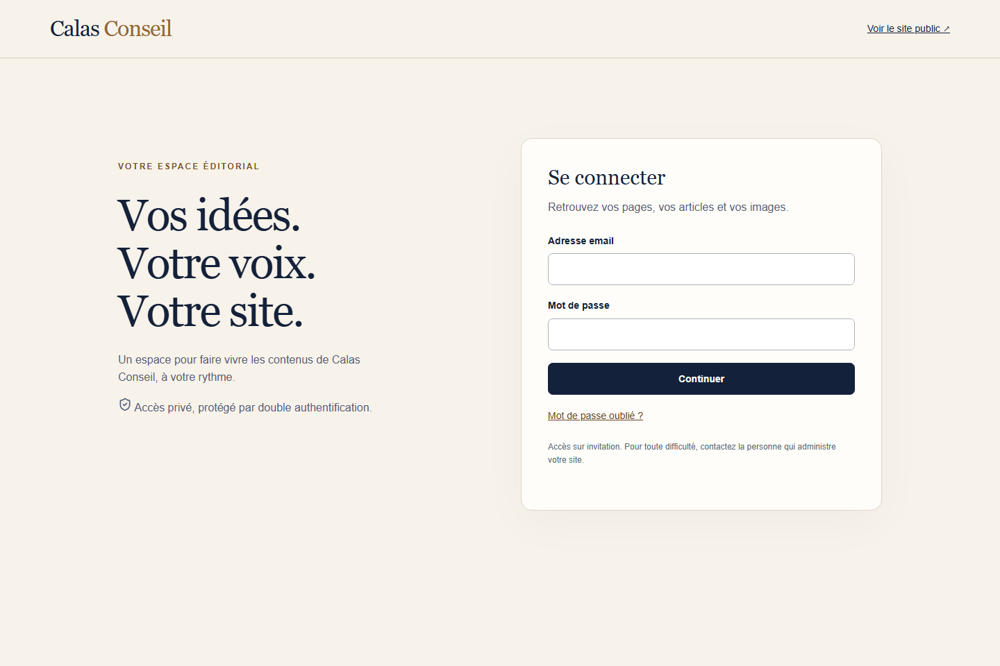
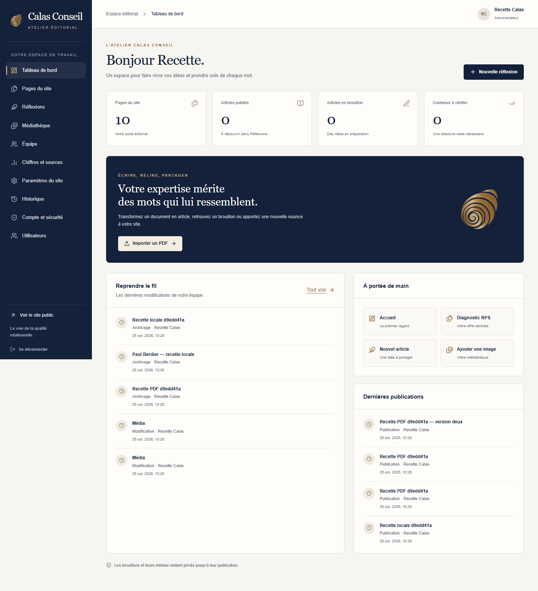
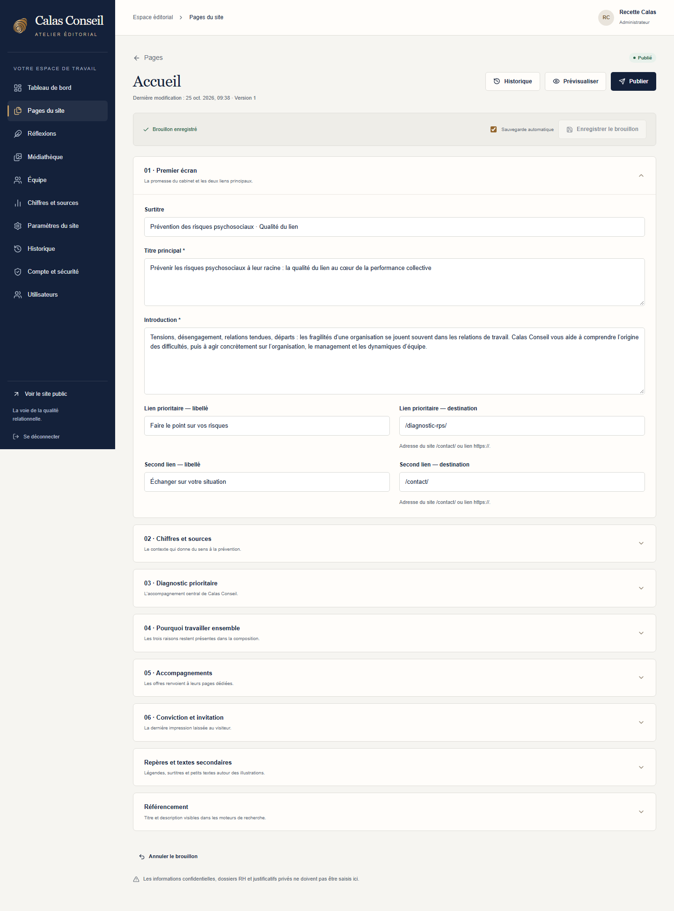
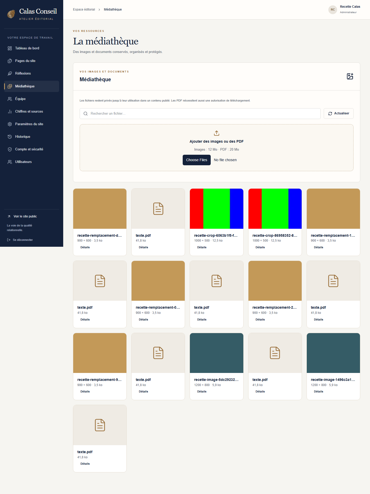
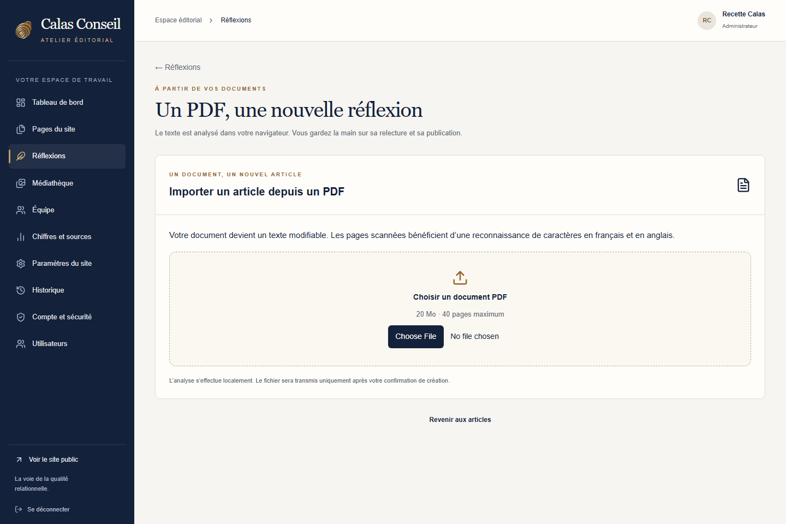
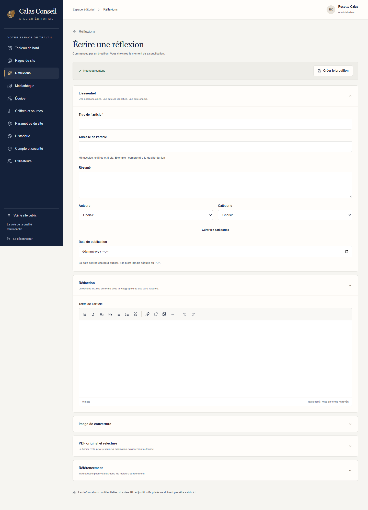
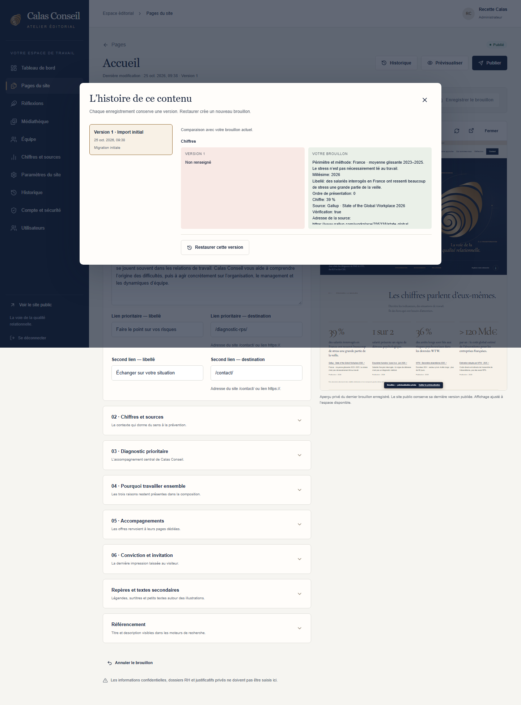

# Faire vivre le site — guide pour Sara

L’**Atelier éditorial Calas Conseil** est l’administration privée du site. Vous y modifiez les textes et les images, préparez vos articles et choisissez leur publication. Aucun compte Sanity, terminal ou outil de programmation n’est nécessaire.

L’administration se trouve à l’adresse du site suivie de `/admin/`. L’adresse définitive sera fournie après installation de la préproduction. Les captures montrent la recette locale du 25 octobre 2026 : le compte « Recette Calas » et les articles « Recette » sont des tests, sans signature de Sara ou d’Agnès.

## Se connecter la première fois

1. Ouvrez le lien d’invitation envoyé par votre administrateur. Il est personnel et valable 24 heures.
2. Choisissez un mot de passe unique d’au moins 12 caractères, puis cliquez sur **Créer mon compte**.
3. Ouvrez le message de vérification d’adresse email et validez votre adresse.
4. Connectez-vous avec votre email et votre mot de passe. Dans **Compte et sécurité**, confirmez votre mot de passe puis cliquez sur **Configurer mon application**.
5. Scannez le QR code dans votre application d’authentification, saisissez les six chiffres affichés et cliquez sur **Activer la protection**.
6. Conservez vos **codes de secours** dans votre gestionnaire de mots de passe. Chaque code s’utilise une seule fois. **Enregistrer mes codes** permet aussi de les télécharger ; gardez ce fichier dans un endroit privé.
7. Cliquez sur **Accéder à mes contenus**.

Lors des connexions suivantes, le site demande votre mot de passe puis le code temporaire de votre application. Ne partagez jamais le QR code, le mot de passe ou les codes de secours.

Les invitations et messages de vérification doivent être raccordés au service email avant la première utilisation réelle. La recette locale les reçoit dans une boîte de test ; aucun message de recette n’a été envoyé à Sara.

## Retrouver ses contenus

Le tableau de bord donne accès à l’accueil, à Diagnostic, au nouvel article et à la médiathèque. Ses compteurs correspondent aux données enregistrées. L’activité récente indique les personnes et les dates des modifications.

Le menu rassemble **Pages du site**, **Réflexions**, **Médiathèque**, **Équipe**, **Chiffres et sources** et **Historique**. Sur téléphone, le bouton de menu ouvre ces rubriques. **Paramètres du site** et **Utilisateurs** sont réservés aux administrateurs.

## Modifier une page

1. Ouvrez **Pages du site**, puis **Accueil**, **Diagnostic RPS** ou la page concernée.
2. Dépliez la section à modifier et ajustez ses textes. L’accueil conserve ses six blocs et Diagnostic ses étapes : la composition reste protégée.
3. Attendez **Brouillon enregistré**. La sauvegarde automatique intervient après une courte pause de saisie ; vous pouvez aussi utiliser **Enregistrer le brouillon**, ou `Ctrl+S` / `Cmd+S`.
4. Cliquez sur **Prévisualiser**. Vérifiez le résultat aux largeurs Ordinateur, Tablette et Mobile.
5. Faites relire, puis cliquez sur **Publier** lorsque le texte est approuvé. Confirmez l’action ; la réussite n’est annoncée qu’après enregistrement par le serveur.

**Enregistrer un brouillon ne change pas le site public.** Celui-ci conserve la dernière version publiée. L’aperçu montre le dernier brouillon enregistré et nécessite votre connexion. Envoyer son adresse seule à une personne sans accès ne lui ouvre pas le brouillon.

Les liens de contact prévus sont `/contact/?objet=diagnostic`, `/contact/?objet=equipes`, `/contact/?objet=managers` ou `/contact/`. Utilisez une adresse complète commençant par `https://` pour les liens externes.

Si l’enregistrement échoue, votre saisie reste à l’écran : corrigez les champs indiqués ou réessayez. Sans confirmation, la modification n’est pas enregistrée. Si une autre personne a modifié le même document, comparez les versions puis rechargez celle du serveur ; recopiez auparavant les passages à conserver. L’outil n’écrase pas automatiquement le travail de votre collègue.

## Ajouter une image ou remplacer un portrait

Dans un champ image, ouvrez la médiathèque et choisissez un fichier existant ou ajoutez une photographie authentique dont vous détenez les droits. Formats acceptés : JPEG, PNG et WebP, jusqu’à 12 Mo par image.

Renseignez le **texte alternatif**, qui décrit le contenu utile aux personnes qui ne voient pas l’image. Ajustez le cadrage et le point d’intérêt, puis vérifiez l’aperçu mobile. Un portrait s’édite dans **Équipe**, sur la fiche de la personne.

Les médias restent privés tant qu’ils ne sont pas utilisés par un contenu publié. Remplacer le fichier d’une image partagée peut modifier ses différentes utilisations : l’opération est réservée à l’administrateur et demande une confirmation explicite. Pour changer seulement une page, sélectionnez une nouvelle image dans cette page. Un fichier lié à un contenu ou à une version conservée ne peut pas être supprimé.

## Créer une réflexion à partir d’un PDF

1. Depuis le tableau de bord ou **Réflexions**, cliquez sur **Importer un PDF** et choisissez votre document.
2. Attendez l’analyse dans votre navigateur. Le texte sélectionnable est lu directement ; les pages scannées passent par la reconnaissance de caractères. Vous pouvez annuler l’analyse.
3. Vérifiez le titre, le résumé et le texte extrait. Le résumé reprend le début du document : ajustez-le. Si une page mélange texte et image et que des passages manquent, utilisez la reconnaissance complète proposée.
4. Cliquez sur **Créer le brouillon**. Le PDF est alors enregistré dans la médiathèque privée et un nouvel article modifiable est créé.
5. Cliquez sur **Ouvrir le brouillon**. Renseignez l’auteure réelle, une catégorie et la date approuvée. Relisez les noms, chiffres, listes, tableaux et paragraphes reconnus, puis remettez le texte en forme.
6. Dans **PDF original et relecture**, confirmez la relecture seulement après cette vérification.
7. Pour proposer le document original aux visiteurs, cochez l’autorisation de téléchargement du PDF. Sans cette autorisation, publier le texte laisse le PDF privé.
8. Prévisualisez, faites relire, puis publiez. Le lien de téléchargement apparaît uniquement si vous l’avez autorisé dans la version publiée.

Limites par import : **20 Mo, 40 pages et 200 000 caractères**. L’OCR peut prendre du temps et faire des erreurs. Le texte devient modifiable ; les illustrations et la mise en page du PDF ne sont pas automatiquement reproduites dans l’article. Le fichier original conserve cette présentation.

En cas de coupure lors de la création, utilisez **Réessayer la création** sur le même écran : la reprise retrouve le même brouillon. Vérifiez ensuite la liste Réflexions avant de recommencer un import.

## Écrire directement un article

1. Dans **Réflexions**, cliquez sur **Nouvelle réflexion**.
2. Renseignez le titre, le résumé et l’adresse lisible proposée à partir du titre. L’adresse d’un article déjà publié est protégée pour préserver les liens.
3. Choisissez l’auteure réelle, une catégorie et la date, nécessaires à la publication. Si une catégorie ou une personne manque, enregistrez d’abord l’article, puis créez et publiez cette fiche avant de revenir.
4. Rédigez dans **Texte de l’article**. La barre propose gras, italique, titres 2 et 3, listes, citation, liens, image, séparation et annulation. Le titre principal vient du champ Titre de l’article.
5. Ajoutez éventuellement une image de couverture et un PDF original. Un PDF ajouté manuellement exige aussi une relecture et une autorisation distincte pour le téléchargement.
6. Cliquez sur **Créer le brouillon**. Vous pourrez ensuite utiliser la sauvegarde automatique, l’aperçu et la publication.

La mise en forme collée depuis un traitement de texte est nettoyée. Relisez les titres et les listes. Aucun article, témoignage, client, portrait ou résultat ne doit être inventé pour remplir le site.

## Vérifier les chiffres et les informations communes

Dans **Chiffres et sources**, chaque indicateur possède sa valeur, son libellé, sa source, son lien, son millésime et ses précisions de périmètre. Vérifiez la source avant de cocher sa validation puis de publier. L’accueil permet de choisir les quatre chiffres affichés. Consultez [SOURCES.md](SOURCES.md) pour les formulations retenues.

Les administrateurs modifient les coordonnées dans **Paramètres du site**. La marque et la signature sont protégées. LinkedIn reste vide tant que son adresse n’est pas confirmée. Le statut IPRP ne doit être activé qu’après contrôle réel de l’attestation ; les justificatifs privés restent conservés séparément.

## Revenir à une version précédente

Le bouton **Historique** présente les versions du contenu, les dates et les personnes intervenues. Sélectionnez une version pour comparer ses champs avec le brouillon actuel. **Restaurer cette version** crée un nouveau brouillon : le site public ne change pas tant que la restauration n’est pas publiée.

**Annuler le brouillon** reprend la dernière version publiée, après confirmation. Pour retirer un article du site, utilisez son action de retrait ou d’archivage puis vérifiez le résultat. L’historique général retrace l’activité du site.

Les versions facilitent les retours éditoriaux. Les sauvegardes de l’ensemble du site sont gérées séparément par la maintenance.

## Retrouver son accès et se déconnecter

**Mot de passe oublié ?** permet de demander un lien personnel. Changer le mot de passe ne supprime pas la double authentification. Si votre téléphone est indisponible, choisissez **Utiliser un code de secours**. Si vous n’avez plus ni application ni code, contactez votre administrateur pour la récupération.

Dans **Compte et sécurité**, vous pouvez changer votre mot de passe, renouveler les codes de secours et fermer des sessions ouvertes. Les anciens codes deviennent inutilisables après leur renouvellement. Terminez avec **Se déconnecter**, surtout sur un ordinateur partagé.

La liste des sessions nécessite une connexion datant de moins de quinze minutes. Si le bouton **Se reconnecter** apparaît, cliquez dessus puis saisissez votre mot de passe et votre code de sécurité : vous reviendrez directement à **Compte et sécurité**. Vous pouvez continuer à travailler sur vos contenus.

## Première prise en main accompagnée

À réaliser en préproduction : modifier un paragraphe de l’accueil, vérifier son aperçu mobile ; remplacer une image ; importer un PDF de test clairement identifié ; relire et publier l’article de test ; vérifier dans une fenêtre non connectée que seul le contenu publié est accessible ; restaurer une version en brouillon puis retirer le test.

La mise en ligne publique reste conditionnée à la validation de l’accueil et de Diagnostic par Sara et Agnès, puis à la relecture finale. Les fonctions décrites ont été vérifiées localement ; l’adresse, les emails et les sauvegardes doivent aussi être vérifiés sur l’hébergement définitif.

Le CMS contient les contenus destinés au site. N’y placez pas de dossiers RH, données médicales, demandes reçues par le formulaire, mots de passe ou documents privés de tiers.
