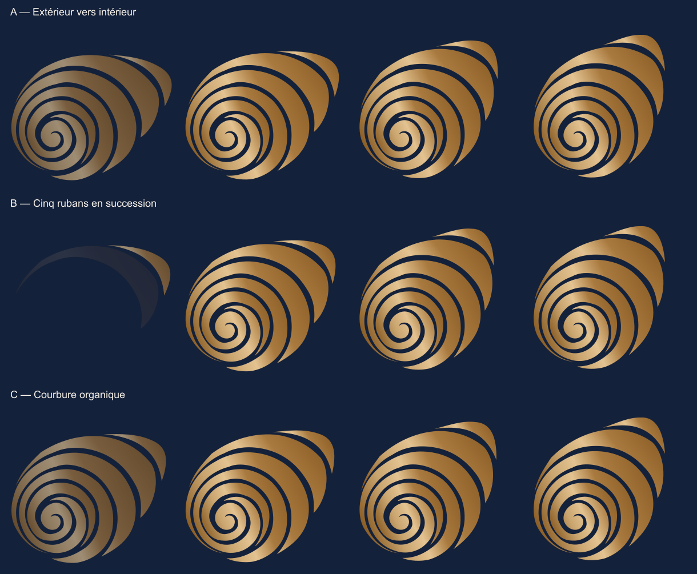

# Identité et mouvement de Calas Conseil

## Source unique et fichiers

Le nom public est **Calas Conseil**, avec un seul s. La référence JPEG n’est jamais servie par le site. Le 26 octobre 2026, le lettrage a été recomposé pour suivre la carte fournie : **CALAS CONSEIL** en capitales fines et contrastées, C initiaux légèrement plus hauts, espacement optique resserré et second mot doré. La base est Cormorant Garamond 300, ajustée dans `scripts/brand-export.mjs` ; cette reproduction ne prétend pas identifier la police originale du JPEG. La signature utilise EB Garamond en capitales espacées.

`wordmark.svg` et `wordmark-dark.svg` contiennent les contours vectoriels communs à l’en-tête, au pied de page, à la connexion et à l’administration. Le navigateur n’a besoin d’aucune police pour afficher le nom : les proportions restent identiques sans JavaScript, en mouvement réduit et lors du chargement des autres polices. Les noms accessibles restent en texte « Calas Conseil ». Le lettrage et la signature sont immobiles ; cette correction ne modifie ni les rubans ni leur animation.

Les cinq rubans proviennent de la silhouette fournie, redessinée en courbes de Bézier. **`assets/brand/geometry.mjs` reste la source unique et n’a pas été modifiée pour la nouvelle animation.** Les vides sont transparents et le noyau est en `(162,373)`. `contours.json` conserve l’étude initiale.

`node scripts/brand-export.mjs` reproduit les variantes SVG et PNG dans `apps/web/public/brand/` : horizontal, empilé, symbole, monochromes, versions pour fond sombre et favicon. Les lettres des exports autonomes sont vectorisées depuis les polices locales. `assets/brand/logo-editable.svg` garde des textes éditables. Les PNG sont exportés à 2× ; le favicon est limité à 64 × 64 px. Le visuel Open Graph mesure 1200 × 630 px.

## Nouvelle direction : s’enrouler vers le noyau

Le brief de migration remplace le déroulement depuis le centre par **un enroulement extérieur vers intérieur**. Le bloc SVG, les lettres, la navigation et les CTA restent immobiles et accessibles. Le symbole se forme une seule fois en **2,2 secondes**, sans parallaxe ni boucle.

Trois variantes ont été construites et examinées à partir des mêmes cinq tracés :

| Variante | Mouvement | Choix |
| --- | --- | --- |
| A — Extérieur vers intérieur | Les cinq contours partent ensemble d’une posture ouverte puis convergent. | Lisible, mais la silhouette complète apparaît très tôt. |
| B — Cinq rubans en succession | La courbure et la contraction accompagnent l’arrivée décalée des rubans, de l’extérieur vers le noyau. | Retenue : la formation de la coquille est la plus perceptible. |
| C — Courbure organique | Une modulation douce de la courbure fait évoluer les contours simultanément. | Conservée comme étude ; le mouvement est plus discret. |

L’étude interactive autonome est [study.html](../artifacts/logo-coil/study.html). La [planche comparative](../artifacts/logo-coil/comparison.png) montre les trois variantes à 0,12 s, 0,70 s, 1,40 s et 2,20 s. La [vidéo comparative](../artifacts/logo-coil/comparison.webm) permet de les revoir ensemble.

## Géométrie et animation livrées

`assets/brand/coil.mjs` contient la déformation, les trois variantes et le rendu des poses. Chaque portion de ruban tourne d’un angle **différent selon sa distance au noyau**, tandis que son rayon se rapproche progressivement de la position finale. Les portions extérieures se courbent davantage que les parties proches du centre. Le noyau reste fixe. Il s’agit d’une modification des contours, sans transformation rigide du bloc ni simple inversion de l’ancien masque.

La variante B fait entrer les rubans dans l’ordre `[4,2,1,0,3]`, avec 100 ms de décalage. Chaque courbure évolue pendant 1,8 seconde. Un bref fondu de 180 ms accompagne l’arrivée ; les contours continuent de se déformer bien après ce fondu. La progression utilise une interpolation cosinus, lente à ses extrémités. Les courbes sont subdivisées une fois pour conserver la douceur des contours pendant la transformation. Leurs constantes polaires sont mémorisées ; les rubans encore invisibles ne calculent pas de posture intermédiaire.

`apps/web/src/lib/motion.ts` pilote cette fonction avec une timeline GSAP Core. À la fin, les cinq attributs `d` sont rétablis **octet pour octet** depuis la source. Aucun masque ou style temporaire ne subsiste. Les poses de `assets/brand/motion-start.svg`, `motion-middle.svg` et `motion-end.svg`, ainsi que leurs PNG, correspondent à 0,12 s, 1,10 s et 2,20 s.

Le HTML de `Shell.astro` contient toujours le symbole final complet. Un script placé **avant le SVG** active une garde CSS uniquement lorsque JavaScript et le mouvement sont disponibles ; cela couvre aussi une première peinture pendant le chargement progressif du HTML. Le script suivant le SVG arme son initialisation et son délai de secours. Si le module ne prend pas la main sous 1 400 ms, le garde-fou affiche le logo final et empêche un démarrage tardif. Sans JavaScript ou avec mouvement réduit, la géométrie finale est immédiatement affichée. Aucun texte ni bouton ne passe par cet état d’attente.

`gsap.matchMedia()` prend aussi en compte un changement de préférence pendant l’animation : la timeline et l’observer sont arrêtés, les contours et leur opacité sont rétablis. Un retour au mouvement normal ne rejoue pas la séquence. `initMotion()` expose un nettoyage complet. Une erreur d’initialisation ou de rendu restaure le logo final.

La séquence commence lorsque le symbole entre dans le champ. Sur mobile, où il se trouve sous le premier écran, aucun contour intermédiaire n’est calculé pendant la lecture de l’introduction. La comparaison locale de sept poses après optimisation conserve une différence moyenne maximale de 0,133 sur 255 par canal et une pose finale strictement identique ; le calcul de 360 images de cinq rubans passe de 769 à 154 ms dans le microbenchmark Node. Ce résultat mesure le calcul géométrique, pas la vitesse de chargement du site. Les données sont conservées dans [performance-comparison.json](../artifacts/logo-coil/performance-comparison.json).

## Vérification de la géométrie

`node scripts/brand-verify.mjs` contrôle la nouvelle étude et conserve les vérifications de l’ancien déroulement :

- **1 515 états** des trois variantes : coordonnées finies et points de contrôle contenus dans le viewBox.
- Noyau fixe, contraction régulière des rayons échantillonnés et courbure différente aux petits et grands rayons.
- Arrivée du ruban extérieur avant le ruban du noyau.
- Durée comprise entre 1,8 et 2,5 secondes et cinq contours finaux exactement identiques aux sources.
- Vérifications historiques : 70 états finis et 22 mesures de surface de l’ancien déroulement.

Ces contrôles numériques complètent la revue visuelle. Ils ne remplacent pas la validation artistique de Sara et Agnès.

## Recette navigateur

`node scripts/logo-coil-check.mjs` contrôle l’enroulement réel dans Chromium et Firefox, à 1440 et 390 px. `BASE_URL` permet de choisir le serveur ; l’adresse par défaut est celle de la recette locale, `http://localhost:4336`.

Le script vérifie la succession extérieure vers intérieure, la déformation intermédiaire, la stabilité du cadre, l’absence de rotation rigide et de débordement, la géométrie finale exacte, l’absence de flash avant initialisation, le changement de préférence pendant l’animation, l’absence de rejeu, le mouvement réduit dès le chargement et le rendu sans JavaScript. Le rapport horodaté est [artifacts/logo-coil/report.json](../artifacts/logo-coil/report.json). Les captures début/milieu/fin et les états statiques portent le nom du navigateur et de la largeur ; [live.webm](../artifacts/logo-coil/live.webm) montre le rendu sur la page réelle.

Recette exécutée le 25 octobre 2026 sur le build standalone local : **48 contrôles réussis** (12 par combinaison navigateur/largeur), sans erreur JavaScript. Firefox nécessite ici une exécution hors sandbox Windows. Cette recette a conduit à déplacer la garde CSS avant le SVG pour supprimer un intervalle de visibilité détecté avant son initialisation.

`node scripts/brand-browser.mjs` reste la recette plus large du mouvement éditorial : dessins des trajectoires, révélations au défilement, progression de lecture et étapes Diagnostic. Les résultats doivent être associés au serveur et à la date du rapport, et non assimilés à une validation d’un hébergement non testé.

`node scripts/motion-loading-check.mjs` vérifie à 390 et 1440 px que l’accueil ne télécharge pas ScrollTrigger au premier écran, que le logo mobile attend son entrée dans le champ et que la méthode Diagnostic charge puis active son animation. Le rapport est [loading-report.json](../artifacts/logo-coil/loading-report.json). L’illustration de premier écran de Diagnostic utilise déjà la parallaxe sur ordinateur : ce cas charge donc le plugin dès son approche.

## Mouvement éditorial conservé

`LinkArt.astro` est distinct du logo. Ses trajectoires et ses arcs ouverts sont décoratifs et masqués aux technologies d’assistance. Les révélations GSAP de 600 ms et le dessin des trajectoires commencent à l’entrée dans le champ, grâce à IntersectionObserver. Les longueurs SVG sont lues ensemble avant l’écriture des styles. ScrollTrigger est importé uniquement à l’approche d’une animation continue : étapes Diagnostic ou parallaxe sur ordinateur. La progression de lecture suit le défilement natif avec une mise à jour groupée par image ; elle ne force aucune mesure de mise en page au chargement.

Le défilement reste natif, sans blocage ni épinglage. La parallaxe des autres décors est limitée à 18 px sur grand écran et ne concerne jamais le logo. Le focus clavier termine une révélation en cours si nécessaire. Les accords natifs `details/summary` restent utilisables sans JavaScript ; le mouvement réduit supprime les effets sans fermer le contenu choisi.

## Archives et références

L’ancien déroulement de 2,34 secondes, depuis le noyau vers l’extérieur, est conservé dans `assets/brand/unfurl.mjs` et dans les captures `artifacts/logo-unfurl/`. La commande historique `logo-unfurl-check.mjs` appelle désormais la recette du nouvel enroulement. Les archives `artifacts/logo-original/` et `artifacts/logo-before-unfurl/` conservent les études précédentes.

La documentation officielle de [gsap.matchMedia](https://gsap.com/docs/v3/GSAP/gsap.matchMedia()/) guide les préférences de mouvement et le nettoyage ; celle de [ScrollTrigger](https://gsap.com/docs/v3/Plugins/ScrollTrigger/) décrit les animations éditoriales. Les versions sont verrouillées dans le lockfile. Les licences des polices OFL sont livrées dans `assets/brand/licenses/`. Aucun générateur d’image ni plugin de morphing supplémentaire n’a été nécessaire.
